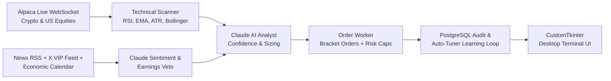

# Envotrade — Open-Source Autonomous AI Trading Terminal

<p align="center">
  <strong>Self-hosted Python algorithmic trading terminal for Crypto &amp; US Equities powered by Anthropic Claude, Alpaca API, and PostgreSQL.</strong><br/>
  Combines technical indicators, real-time news &amp; X (Twitter) sentiment, earnings vetoes, self-optimizing feedback loops, and a native desktop CustomTkinter GUI.
</p>

<p align="center">
  
  
  
  
  
</p>

> **Disclaimer:** Envotrade is an open-source research and educational trading platform. It is **not financial advice**. Always validate strategies in **paper trading mode** (`ALPACA_MODE=paper`) and understand the risks of algorithmic trading before risking real capital.

---

## Architecture & Decision Pipeline



---

## Key Features

- **Dual Asset Classes (Crypto & US Equities)**: Dedicated coordinators, WebSocket stream workers, and scanners for both 24/7 crypto pairs and liquid US mega-cap equities (`NVDA`, `AAPL`, `MSFT`, `SPY`, `QQQ`, etc.).
- **Hybrid AI + Quantitative Engine**: Pairs deterministic technical filters (RSI, 15m EMA trend filter, ATR stop-loss/take-profit, index-health filter) with **Anthropic Claude** trade reasoning and confidence scoring.
- **Sentiment & Macro Guardrails**: Ingests breaking news RSS feeds (CoinDesk, CoinTelegraph, Decrypt), curated X/Twitter VIP accounts, economic calendar events, and automatic earnings-date vetoes.
- **Strict Risk Management**: Hard capital exposure caps (`MAX_TRADING_CAPITAL`), per-trade notional limits (`NOTIONAL_PER_TRADE`), ATR-based bracket orders, and EOD flattening for US stocks.
- **Self-Optimizing Learning Loop & Backtesting**: Persists every trade, reasoning trace, and outcome to PostgreSQL, includes an auto-tuner (`brain/auto_tuner.py`), and ships with a backtest harness (`tools/backtest.py`).
- **Non-Blocking Desktop Terminal UI**: Built with **CustomTkinter** and **Matplotlib / mplfinance** with dark/light themes, live console, portfolio donut chart, sentiment feed, and trade reasoning inspector. Includes a macOS `.app` launcher bundle (`Envotrade.app`).

---

## Tech Stack

| Layer | Technology |
| :--- | :--- |
| **Language** | Python 3.11+ |
| **Brokerage & Market Data** | `alpaca-py` (WebSocket streaming + REST bracket orders) |
| **AI & Sentiment** | Anthropic Claude (`anthropic`), `feedparser`, RapidAPI X/Twitter |
| **Quantitative & Charts** | `pandas`, `numpy`, `matplotlib`, `mplfinance` |
| **Desktop GUI** | `customtkinter`, `pillow` |
| **Database** | PostgreSQL (`psycopg2-binary`, `database/schema.sql`) |

---

## Quick Start

### 1. Prerequisites
- **Python 3.11+** (3.12 recommended on macOS)
- **PostgreSQL 14+**
- **Alpaca Markets** account (free paper trading keys work out of the box)
- **Anthropic API key**

### 2. Clone & Install
```bash
git clone https://github.com/enveryurtsever/envotrade.git
cd envotrade
python3 -m venv .venv
source .venv/bin/activate
pip install -r requirements.txt
```

### 3. Configure Environment
```bash
cp .env.example .env
```
Edit `.env` and fill in your PostgreSQL credentials, `ALPACA_KEY` / `ALPACA_SECRET` (keep `ALPACA_MODE=paper` for testing), and `ANTHROPIC_API_KEY`.

### 4. Initialize Database & Launch
```bash
psql -h localhost -U envotrade -d envotrade -f database/schema.sql
python main.py
```
On macOS, you can also double-click `Envotrade.app` once `.venv` is installed.

### 5. Run Backtests
```bash
python tools/backtest.py
```

---

## Security

See [SECURITY.md](SECURITY.md) for credential safety guidelines and vulnerability reporting.

## Contributing

Contributions are welcome — see [CONTRIBUTING.md](CONTRIBUTING.md).

## License

Released under the [MIT License](LICENSE).
